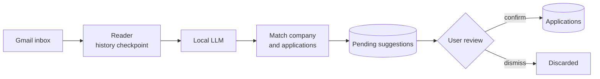

# Job Application Tracker

A web app that keeps track of every job application. Instead of depending on job postings or on remembering to log each application by hand, it watches your Gmail for the confirmation, interview and rejection emails that companies send, reads them with a local language model, and turns them into suggested records that you review and confirm.

It started as a manual tracker and gained an email workflow: the Gmail API feeds a local LLM that classifies each email and extracts the company, job title and status. Nothing is written to as a real records until confirming it.

This is also a learning project, used as a chance to practise software architecture, new tech stacks and integrate AI into a software application.

## Features

**Manual tracker**
- **Full CRUD** for job applications and companies, with duplicate company detection so the same company never gets created twice for one user
- **Status history as a real event log**, every status change is
  recorded with a timestamp, showing the full timeline of an application rather than just its current state
- **Job posting storage** — paste the full posting text against an
  application so it's preserved even after the original listing gets
  taken down
- **Authentication**, ASP.NET Core Identity, JWT access + refresh token pair, httpOnly cookies, automatic silent token refresh on the frontend
- **Company-aware search**, a searchable company picker when logging a new application, with the option to add a new company inline

**Email automation**
- **Gmail detection**, new inbox mail is read through the Gmail API and classified by a local model. The model decides whether an email is about an application the user actually made, and extracts the company, job title and status
- **Review inbox**, every detection becomes a suggestion: a new application or a status change for one the user already track. Ability edit the guesses, then confirm or dismiss
- **Background sync**, the mailbox is checked automatically every 30 minutes, or on demand with a "Check now" button. Both go through the same sync, so they can never run at the same time
- **Mailbox page**, connect Gmail, see the sync state and the result of the last run, and reconnect when Google's connection expires

## How it works



1. **Find new mail.** The reader asks Gmail only for messages added to the inbox since the last saved checkpoint, so each email is looked at once.
2. **Classify.** Each email goes to the local model, which returns structured JSON: whether it concerns one of your applications, what kind of message it is, and the company, title and status.
3. **Match.** The company name is compared with existing companies. An email about an application the user do not track becomes a suggested new application. A status email for one already track becomes a suggested status change.
4. **Review.** Suggestions wait in the review inbox. Confirming one creates the real record through the same services as manual entry, and records the email it came from.

## Tech stack

**Backend**
- ASP.NET Core (.NET 10) Web API
- Entity Framework Core + SQL Server
- ASP.NET Core Identity
- JWT bearer authentication (httpOnly cookies, access/refresh rotation)
- Gmail API
- Ollama, model phi4-mini
- Hosted background services for syncing and polling

**Frontend**
- React + TypeScript (Vite)
- TanStack Query for data fetching and cache invalidation
- React Router
- Tailwind CSS + shadcn/ui
- Sonner, Lucide

### Prerequisites

- .NET 10 SDK
- SQL Server and the dotnet-ef tool
- Node.js and npm
- For the email automation only: Ollama and a Google account

### Core app

The manual tracker works on its own. Start here.

**Backend**

```bash
cd backend
dotnet restore
dotnet ef database update
dotnet run
```

Requires a local SQL Server instance and a `DefaultConnection` string
in `appsettings.Development.json`, plus the JWT signing settings the
authentication setup reads.

**Frontend**

```bash
cd frontend
npm install
npm run dev
```

The dev server runs on `http://localhost:5173` and proxies `/api`
requests to the backend — see `vite.config.ts`. Open it, register an
account and log in.

### Email automation (optional)

**1. Local model**

Install Ollama, then pull the model:

```bash
ollama pull phi4-mini
```

Ollama listens on `http://localhost:11434`.

**2. Google Cloud**

1. Create a project in the Google Cloud console and enable the Gmail API.
2. Configure the OAuth consent screen: audience External, publishing status Testing, add your own Google account as a test user, and the scope `gmail.readonly`.
3. Create an OAuth client of type Web application with these authorized redirect URIs:
   - `http://localhost:5173/api/mailbox/oauth/callback`
   - `https://localhost:7060/api/mailbox/oauth/callback`
4. Store the client credentials as user secrets:

```bash
cd backend
dotnet user-secrets set "Google:ClientId" "<your client id>"
dotnet user-secrets set "Google:ClientSecret" "<your client secret>"
```

**3. Configuration**

Set these in `appsettings.Development.json`:

| Setting | Meaning | Default |
|---|---|---|
| `Google:RedirectUri` | The callback URL registered above | none |
| `Google:FrontendReturnPath` | Where the app returns after connecting | `/mailbox` |
| `Ollama:BaseUrl` | Where Ollama listens | `http://localhost:11434` |
| `Ollama:Model` | Model used for classification | `phi4-mini` |
| `Ollama:NumCtx` | Context window passed to the model | `2048` |
| `Sync:PollingEnabled` | Check the mailbox automatically | `true` |
| `Sync:PollIntervalMinutes` | Minutes between automatic checks | `30` |
| `Sync:StartupDelaySeconds` | Wait before the first automatic check | `60` |

**4. Use it**

1. Start the backend and the frontend, and open `http://localhost:5173`.
2. Go to mailbox and click connect gmail. The first sync starts from the moment of connection; older mail is not imported.
3. New mail is checked automatically, or press check now. A batch of emails can take a few minutes because the model runs locally.
4. Open review. Each card shows the email and what was detected. Edit the details, then confirm or dismiss.

## Limitations

- **A small model makes mistakes.** phi4-mini fits on a 4 GB laptop GPU, but it treats a job alert/ads email as job related.
- **It is slow on modest hardware.**
- **Google's testing mode expires the connection.** While the OAuth app is in Testing, the Gmail connection stops working after about a week and the Mailbox page asks for reconnect.
- **Gmail only, inbox only.** Other providers and mail filed under Spam are not read.
- **Built for personal use.** For now.